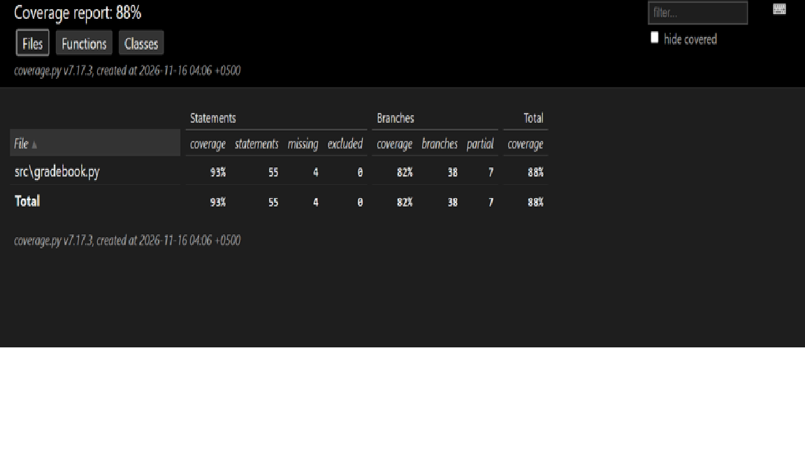
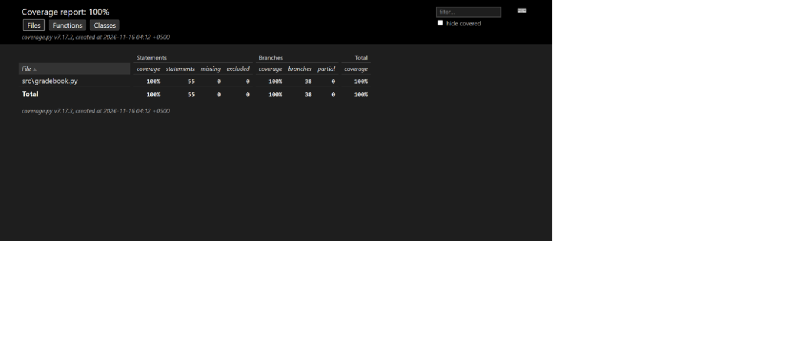
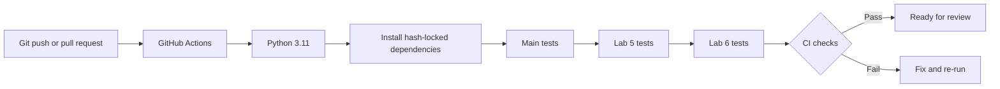

<div align="center">


<a href="https://github.com/Yougeshkumar7/sqe-gradebook-management">
  
</a>

**A Python gradebook and hands-on Software Quality Engineering laboratory project.**  
From input validation and boundary-value tests to continuous integration, static analysis, and branch coverage.

[](https://github.com/Yougeshkumar7/sqe-gradebook-management/actions/workflows/ci.yml)
[](https://sonarcloud.io/summary/new_code?id=Yougeshkumar7_sqe-gradebook-management)
[](https://www.python.org/)
[](https://pytest.org/)
[](#coverage-results)
[](LICENSE)

[**Features**](#features) · [**Run locally**](#getting-started) · [**Testing**](#testing-and-coverage) · [**Lab timeline**](#software-quality-engineering-journey) · [**Quality & security**](#static-analysis-and-security) · [**Evidence**](#coverage-evidence)

</div>

---

## Overview

**SQE GradeBook Management** is a small, testable Python application for storing student records and grades. It is also a practical record of Software Quality Engineering (SQE) work: Git/GitHub collaboration, issue-driven fixes, test design, pytest automation, CI, SonarCloud, and coverage analysis.

> [!NOTE]
> This repository is a **Python codebase and testing project**, not a hosted website or graphical application. The results below describe the tested `src/gradebook.py` module and the documented lab runs; they are not a claim that every lab folder has 100% coverage.

## Highlights

| Area | Result / implementation |
| :--- | :--- |
| Core app | Student records, numeric scores, averages, letter grades, student lookup |
| Defensive validation | Empty/invalid names, blank IDs, invalid scores, out-of-range scores, duplicate roll numbers |
| Test suite | **29 passing tests** in the Lab 11 local run (16 Nov 2026) |
| Line coverage | **93% → 100%** for `src/gradebook.py` |
| Branch coverage | **82% → 100%** for `src/gradebook.py` |
| Overall measured coverage | **88% → 100%** (line + branch coverage report) |
| Static analysis | SonarCloud **Quality Gate: Passed** after security fixes |
| Automation | GitHub Actions workflow tests the main suite plus Lab 5 and Lab 6 |
| Dependency integrity | Hashed, version-pinned `requirements.lock` used by CI |

## Features

- **Student management:** create students with names and roll numbers; add students to a gradebook.
- **Input validation:** reject empty roll numbers, invalid or blank names, booleans and non-numeric scores, and scores outside **0–100**.
- **Grade calculations:** record multiple scores, calculate their arithmetic average, and assign a letter grade.
- **Duplicate protection:** prevent two students in the main gradebook from sharing a roll number.
- **Search:** find a student by name (case-insensitive) or by exact roll number; return `None` when there is no match.
- **Regression tests:** validate normal behavior, boundaries, invalid inputs, duplicate records, and unsuccessful searches.

### Grade scale in `src/gradebook.py`

| Score | Grade |
| :---: | :---: |
| 80–100 | A |
| 70–79 | B |
| 60–69 | C |
| 50–59 | D |
| 0–49 | F |

> Lab 6 contains its **own** grading exercise and boundary cases, so its grade thresholds are not necessarily the same as the core module's.

## Getting started

### Requirements

- Python **3.11** (used by CI and SonarCloud configuration)
- Git
- Internet access for the initial dependency installation

### 1. Clone the project

```bash
git clone https://github.com/Yougeshkumar7/sqe-gradebook-management.git
cd sqe-gradebook-management
```

### 2. Create a virtual environment

**Windows PowerShell**

```powershell
py -3.11 -m venv .venv
.\.venv\Scripts\Activate.ps1
```

**macOS / Linux**

```bash
python3.11 -m venv .venv
source .venv/bin/activate
```

### 3. Install dependencies

For the same pinned, hash-verified test dependencies used by GitHub Actions:

```bash
python -m pip install --only-binary=:all: --require-hashes -r requirements.lock
```

For **local coverage reporting**, install the additional development tool separately:

```bash
python -m pip install pytest-cov
```

`pytest-cov` is used for the Lab 11 coverage report; it is **not currently listed in `requirements.lock`**.

### 4. Try the gradebook

```python
from src.gradebook import Student, GradeBook

book = GradeBook()
student = Student("Ali", "001")

student.add_score(90)
student.add_score(80)
book.add_student(student)

print(student.average())                      # 85.0
print(student.grade_letter(85))               # A
print(book.find_student_by_name("ali").name)  # Ali
print(book.find_student_by_roll_number("999"))  # None
```

## Testing and coverage

### Run the main test suite

```bash
python -m pytest tests -v
```

### Generate line and branch coverage

```bash
python -m pytest tests --cov=src --cov-branch --cov-report=term-missing --cov-report=html
```

Open **`htmlcov/index.html`** in a browser to see line-by-line highlights and missing branches. The generated `htmlcov/` directory is intentionally ignored by Git.

### Check an 85% minimum threshold

```bash
python -m pytest tests --cov=src --cov-branch --cov-report=term-missing --cov-fail-under=85
```

This command returns a non-zero exit code if coverage falls below the threshold. It is the **verified threshold command** for Lab 11; it does not imply that the present GitHub Actions workflow already enforces coverage or uploads it to SonarCloud.

### Coverage results

| Measurement | Baseline | After adding tests |
| :--- | ---: | ---: |
| Statement coverage | 93% | **100%** |
| Branch coverage | 82% | **100%** |
| Combined coverage report | 88% | **100%** |
| Missed statements | 4 | **0** |
| Partial branches | 7 | **0** |

**Scope:** the main Gradebook file, `src/gradebook.py` (55 statements and 38 branches in the recorded report). **Last recorded local run:** 29 tests passed, with one non-failing Windows C-tracer warning.

The added tests target invalid score types and ranges, missing students by name or roll number, and nonduplicate student additions. High coverage shows code execution, **not** that every possible bug has been eliminated.

### Run earlier lab test suites

The CI workflow runs these suites independently because some lab folders have similarly named test modules and different import layouts:

```bash
python -m pytest -q tests
PYTHONPATH=. python -m pytest -q lab5/tests
cd lab6 && python -m pytest -q
```

On **Windows PowerShell**, use the equivalent commands:

```powershell
py -3.11 -m pytest -q tests
$env:PYTHONPATH = "."
py -3.11 -m pytest -q lab5/tests
Push-Location lab6
py -3.11 -m pytest -q
Pop-Location
```

Running an unrestricted `pytest` from the root may cause **collection conflicts** between exercises in different lab directories. Run each lab's tests separately as shown.

## Coverage evidence

The following images are from the repository's actual Lab 11 reports:

<table>
  <tr>
    <th>Before — 88% combined</th>
    <th>After — 100% combined</th>
  </tr>
  <tr>
    <td></td>
    <td></td>
  </tr>
</table>

Detailed notes: **[Lab 11 — Coverage Analysis](docs/coverage-notes.md)** · [Coverage test cases](tests/test_coverage_gaps.py)

## Static analysis and security

SonarCloud analyzes the code and GitHub Actions workflow for security and maintainability issues. During **Lab 10**, the analysis identified risky Python dependency installation practices. Those were addressed by:

1. Using `--only-binary=:all:` to avoid installation from source distributions in the CI dependency step.
2. Generating **`requirements.lock`** with exact versions and verified hashes, then installing with `--require-hashes`.
3. Re-running the analysis until **the Quality Gate passed**.

| SonarCloud metric | Earlier analysis | After the fixes |
| :--- | :---: | :---: |
| Security rating | C | **A** |
| Open security issues | 4 | **0** |
| Quality Gate | Not computed | **Passed** |
| Overall duplication | 39.4% | 39.3% |
| Coverage shown inside SonarCloud | Not reported | Not reported |

> [!IMPORTANT]
> **39.3% duplication is still reported.** Also, local pytest coverage is not automatically the same as SonarCloud coverage: CI would need to produce and provide a coverage report to SonarCloud for that metric to appear there.

Read the evidence in **[Lab 10 — SonarCloud Findings](docs/sonar-findings.md)** or view the [SonarCloud project](https://sonarcloud.io/summary/new_code?id=Yougeshkumar7_sqe-gradebook-management).

## Continuous integration

The existing [GitHub Actions CI workflow](.github/workflows/ci.yml) runs on pushes to `main`/`master` and pull requests.



SonarCloud also analyzes the pull request and reports a separate Quality Gate result. A successful CI test run and a passing Quality Gate are **two distinct checks**.

## Software Quality Engineering journey

| Lab / practice | Work demonstrated |
| :--- | :--- |
| **Git & GitHub workflow** | Branches, issue tracking, focused commits, pull requests, reviews, and merges |
| **Lab 5 — Test design** | Student/roster tests, input limits and invalid score-count scenarios |
| **Lab 6 — Boundary value analysis** | Tests around letter-grade boundaries and invalid values |
| **Lab 7 — Unit testing** | Reusable pytest fixtures, isolated student tests, and roster-focused exercises |
| **TDD practice** | Red/green/refactor-style changes and test work tracked in feature-branch commits |
| **Lab 10 — Static analysis** | SonarCloud project setup, issue triage, security fixes, lockfile, and passing Quality Gate |
| **Lab 11 — Automated coverage** | Baseline HTML report, added missing tests, 100% recorded line/branch coverage, and 85% threshold verification |

This repository demonstrates **incremental development**: make a small change, test it, review its quality, and commit it with a useful history.

## Project structure

```text
sqe-gradebook-management/
├── .github/
│   └── workflows/
│       └── ci.yml                  # GitHub Actions tests
├── src/
│   └── gradebook.py                # Core Student and GradeBook classes
├── tests/
│   ├── test_gradebook.py           # Main behavioral tests
│   └── test_coverage_gaps.py       # Extra branch/error-path tests
├── lab5/                          # Earlier test-design exercises
├── lab6/                          # Boundary-value exercises
├── lab7/                          # Fixtures and unit-testing exercises
├── docs/
│   ├── sonar-findings.md           # Lab 10 analysis
│   └── coverage-notes.md           # Lab 11 coverage notes
├── screenshots/
│   ├── coverage_before.png         # 88% baseline
│   └── coverage_after.png          # 100% result
├── .gitignore
├── LICENSE
├── requirements.txt               # Direct requirements
├── requirements.lock              # Pinning + SHA-256 hashes
├── sonar-project.properties       # SonarCloud configuration
└── README.md
```

*Additional coursework folders may exist on individual branches or local copies.*

## Git & contribution workflow

```bash
# Start from the latest main branch
git switch main
git pull origin main

# Work on an isolated change
git switch -c feature/describe-change

# Run the tests before committing
python -m pytest tests -q

# Stage and record only the intended files
git add <file-or-folder>
git commit -m "test(gradebook): cover another edge case"
git push -u origin feature/describe-change
```

Open a pull request into `main`, review **Files changed**, ensure GitHub Actions and SonarCloud checks pass, then merge. Use focused Conventional Commit messages such as `feat:`, `fix:`, `test:`, `docs:`, `refactor:`, and `chore:`.

## Improvements to explore

- Report test coverage directly to SonarCloud in CI.
- Reduce the remaining duplicated code where practical.
- Add a permanent CI coverage threshold and test-quality improvements.
- Expand negative/edge-case assertions when introducing new functionality.

These are **possible next steps**, not completed features.

## License and maintainer

Released under the **[MIT License](LICENSE)**.  
Maintained by **[Yougeshkumar7](https://github.com/Yougeshkumar7)**.

<div align="center">

**Built with Python • Verified with pytest • Reviewed with SonarCloud**


</div>
